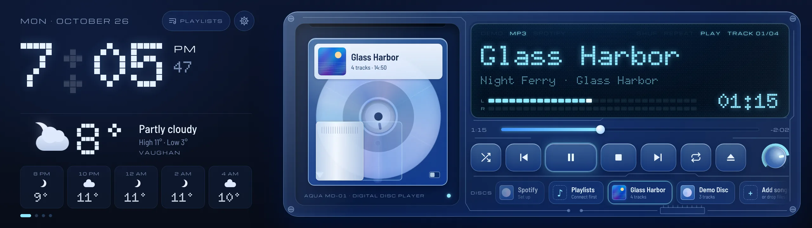

# Aqua MD

A see-through, MiniDisc-style music player for Linux (plus Windows, Mac and Android betas, and a [web version](https://danii45.github.io/Aqua-MD/app/)), made for the Corsair Xeneon Edge (2560 × 720) and happy in any window.



- **Spotify, built in:** log in once and Aqua MD plays Spotify by itself (Spotify Premium needed). It also controls the Spotify desktop app.
- **Your own music:** MP3, M4A, FLAC, WAV, OGG, plus the sound from MP4 and MOV videos. Each album becomes a disc.
- **Seven colours:** give any disc or playlist a colour and the whole app fades to it.
- **Widget pages:** clock, weather, lyrics, now playing, up next, system stats and calendar, on pages that take turns.
- **Lyrics:** from a `.lrc` file next to the song, the song file itself, or [LRCLIB](https://lrclib.net).
- **Any window:** full screen on the Edge, or a normal resizable window. Bigger windows fit more widgets.

## Download

Get the latest `.AppImage` from [Releases](https://github.com/Danii45/Aqua-MD/releases).

1. Download the file.
2. Right-click it → Properties → Permissions, and tick the box that makes it executable.
3. Double-click it.

Built and tested on Kubuntu (x86_64).

### Windows (beta)

Download `AquaMD-Windows-Beta-Setup.exe` from [Releases](https://github.com/Danii45/Aqua-MD/releases) and double-click it. It installs for your user and adds Aqua MD to the Start menu and desktop.

- It isn't code-signed yet, so Windows may say "Windows protected your PC": click **More info → Run anyway**.
- It's a beta and hasn't been tested much on Windows yet. If the built-in Spotify player doesn't work, Aqua MD shows and controls the Spotify app through your Spotify account instead.
- CPU and GPU temperatures aren't shown on Windows.
- Please report problems in [Issues](https://github.com/Danii45/Aqua-MD/issues).

### Mac (beta)

Download `AquaMD-Mac-Beta.zip` from [Releases](https://github.com/Danii45/Aqua-MD/releases), double-click it and drag **Aqua MD** into Applications. For Macs with Apple chips (M1 and newer).

- It isn't notarized by Apple yet. The first time, macOS says it can't check it: click **Done**, then **System Settings → Privacy & Security → Open Anyway**.
- If the built-in Spotify player doesn't start, Aqua MD shows and controls the Spotify app instead.

### Web / Chrome OS

Open **[danii45.github.io/Aqua-MD/app](https://danii45.github.io/Aqua-MD/app/)** in Chrome or Edge. Click the Install icon in the address bar to give it its own window. Spotify plays right in the browser on computers and Chromebooks; songs you add are saved in that browser.

### Android (beta)

Download `AquaMD-Android-Beta.apk` from [Releases](https://github.com/Danii45/Aqua-MD/releases) on your phone and open it. Needs Android 8 or newer.

- It isn't on the Play Store, so Android asks you to allow installing it, and Play Protect may warn you: tap **More details → Install anyway**.
- The deck rearranges itself into a column when you hold the phone upright.
- Spotify plays through the Spotify app (Premium needed); you pick playlists and control it in Aqua MD.
- Add your own songs with **Add songs**. They're copied into the app, so they keep working if you move the files.

## Spotify setup

In Aqua MD, open Settings → Spotify and follow the steps: create a free app on the Spotify developer dashboard with the redirect URI `http://127.0.0.1:43821/callback`, tick Web API and Web Playback SDK, and paste its Client ID.

The Android app uses the same redirect URI and Client ID: it logs in through your phone's browser and catches the answer on `127.0.0.1:43821` itself.

The web version uses the same Client ID with one more redirect URI: `https://danii45.github.io/Aqua-MD/callback/`.

## Build from source

```sh
npm install
npm start            # run it
npm run dist         # build dist/AquaMD-<version>-x86_64.AppImage
npm run dist:win     # Windows installer; needs castLabs Electron for win32-x64 unpacked in ../castlabs-win
npm run dist:mac     # Mac app (zip); needs castLabs Electron for darwin-arm64 in ../castlabs-mac and rcodesign
node tools/build-apk.js 0.4.0-beta.3 3   # Android APK (see below)
node tools/build-web.js docs/app 0.4.1 --web   # web version, served by the website
```

The Mac app is signed ad hoc with [rcodesign](https://github.com/indygreg/apple-platform-rs) (`$RCODESIGN`), which runs on Linux.

The Android app is a small native shell (`android/`) around the same interface, built for the browser by
`tools/build-web.js` (`web/platform.js` stands in for Electron's main process). `tools/build-apk.js` builds it
without Gradle, using Ubuntu's packages: `sudo apt install aapt apksigner zipalign android-sdk-platform-23 dalvik-exchange`.
Keep the signing key it creates in `~/.aqua-md-keys`: updates only install over the app when signed with the same key.

Built with castLabs Electron (Electron with Widevine), which Spotify's Web Playback SDK needs.

The `docs/` folder holds the project's website (served by GitHub Pages).

Not made by or affiliated with Sony, Spotify or Corsair. MiniDisc, Spotify and Xeneon are trademarks of their owners.
